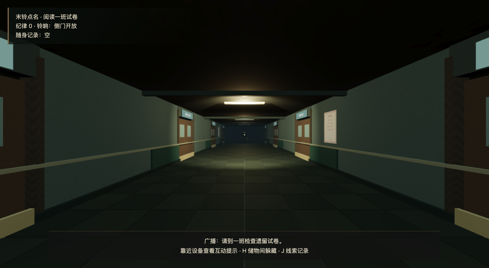

# 末铃点名 · 桌面单机恐怖逃生（开发中）
虚构的昭川中学里，晚自习已经结束，广播仍在点名。探索教室、档案室与广播室，寻找离校方法，避开仍在巡查的值班人。



主要交付是离线运行的桌面软件。[下载 v0.6.0 开发预览](https://github.com/Tomhao10225101490/midnight-rollcall/releases/tag/v0.6.0)，无需安装Node或打开浏览器。当前主流程已通过通关与发布验证；高级商业音画品质和首次体验时长仍未完成最终验收。20—30分钟是设计目标，不是已测游玩时长。

## 下载与启动
M系列Mac选arm64 DMG/ZIP；Intel Mac选x64；Windows可选安装EXE或便携EXE；Linux可选AppImage或tar.gz。具体启动与未签名提示见[安装说明](docs/INSTALL.md)。应用无开发者签名与苹果公证，不保证没有系统提示。

本机已下载的DMG/ZIP位于 `release/downloads-0.6.0/`；ZIP解出的实际发行应用为 `artifacts/downloaded-0.6.0/末铃点名.app`，可双击运行。同源本机构建另存于 `release/candidate-0.6/mac-arm64/末铃点名.app`。旧的 `release/mac-arm64` 仍是0.4，不代表最新版。

## 操作与玩法
WASD移动、鼠标/方向键观察、Shift奔跑、Ctrl潜行、E互动、H在储物柜前藏入/退出、J查看记录/楼层示意图/逐级提示、Esc暂停。柜内只能通过通风缝观察，被目击藏入会遭搜查。

奔跑制造声音并提高纪律值；安静行动逐步降低。值班人丢失视线后会检查最后动静位置及附近。铃响期间值班人停步听令、出口开放十二秒；不要碰到他。试卷、监考登记、档案、频道索引与配电记录构成完整解谜链。关键进度自动存档，设置保存到本机。

恐怖追逐，无血腥，无镜头晃动或刻意闪烁。请先调低音量；出现晕动不适时暂停。支持音量、灵敏度、视野、全屏、画面比例和接触阴影设置。

## 验证范围
本次包对应固定提交 `44290b21ad99b54ea31e6987a2c37fc48cff28c6`。新增立体窗户与档案柜细节、按米平铺的建筑材质、灯具对应动态阴影、五段原创配乐和离线中文字体；修复重开追逐残留及快速关闭面板的鼠标锁定事件竞争。

全部9个包已检查内部入口/版本及53个递归运行模块，远端大小与SHA256逐个匹配，详见[产物清单](docs/ARTIFACTS-0.6.0.md)。

| 平台 | 0.6.0实际产物 | 验证范围 |
|---|---|---|
| macOS arm64 | DMG、应用ZIP | 实际下载ZIP完整网络禁用键盘通关；菜单/鼠标锁定/设置通过；DMG挂载和安装入口通过 |
| macOS x64 | DMG、应用ZIP | 对应系统构建、包检查通过，未实机试玩 |
| Windows x64 | 安装EXE、便携EXE | 对应系统构建、包检查通过，未实机试玩 |
| Linux x64 | AppImage、tar.gz | 对应系统构建、包检查通过，未实机试玩 |
| Web | 静态ZIP | Chrome基础启动、菜单、暂停及包检查；未整局试玩 |

完整键盘路线经历3次被捕后通过正常检查点续玩，没有瞬移、无敌或物品注入。网络禁用由Playwright会话离线模式实现，完整路线HTTP请求为零。熟知路线的自动操作不能代表首次玩家时长；音频图和本地播报状态检查不代表主观听感验收。[完整报告](FINAL_REPORT.md)。网页试玩未部署。

## 从源码运行、测试与构建
Node.js 22及以上，在本项目目录运行：
```sh
npm ci
node node_modules/electron/install.js
npm run desktop
```
逻辑测试与构建：
```sh
npm run typecheck
npm test
npm run build
npm run dist
npm run dist:web
```
`npm run dist`生成当前系统的桌面包；跨平台发布使用对应系统的GitHub Actions runner。`npm run dev`在本机4173端口运行辅助浏览器构建。

以下桌面自动回归脚本已在macOS实测；默认使用Mac Electron，可通过 `ELECTRON_PATH` 指定应用可执行文件：
```sh
npm run test:desktop
npm run test:traverse
npm run test:search
npm run test:map
npm run test:defeat
npm run test:mix
npm run test:fonts
npm run test:score-reset
npm run test:pointer-transition
npm run test:ending-music
```
`test:traverse`使用正常键鼠路线、只读观察状态。macOS/Linux shell可用 `ROLLCALL_OFFLINE=1 npm run test:traverse`进行网络禁用回归。`test:mix`需要系统已安装离线中文语音。`npm run test:panels`直接挂载界面组件检查布局和输入，仅为组件验证。

## 原创与许可
原创代码MIT。几何、标牌、材质纹理和合成音乐由项目代码生成；不使用下载模型或音频。随包内置离线Noto Sans SC字体，按SIL OFL 1.1单独保留许可、版权与来源。中文语音只尝试本机离线系统声音，无声音时保留提示音与完整字幕。第三方软件保持各自许可，详见[第三方声明](THIRD_PARTY_NOTICES.md)。无账号系统、后端或遥测。

## English Quick Start
Offline desktop game under development. [Download the 0.6.0 preview](https://github.com/Tomhao10225101490/midnight-rollcall/releases/tag/v0.6.0) for a bundled desktop app. From source: `npm ci`, `node node_modules/electron/install.js`, then `npm run desktop`. Use `npm test`, `npm run build`, and `npm run dist` for tests and native packaging. Final visual/audio quality and first-player duration acceptance remain pending.


字体缺失恢复测试：先保持 `npm run dev` 运行，再执行 `node scripts/font-failure-browser.mjs`。该脚本临时阻止字体请求，检查错误提示后解除阻止并重试。桌面测试须保持窗口可获得焦点。

当前main为0.7.0候选版，新增门扇近景细节并修正跨门洞的装饰压条；已验证的庭院开发应用（元数据0.7.0-dev.1）放在 `release/courtyard-0.7/mac-arm64/末铃点名.app`。上述下载与发布验收仍对应0.6.0。

0.7门扇碰撞回归：`npm run test:door-collision` 使用正常键盘检查防夹、打开门扇阻挡和绕行；公开0.6尚不含该修复。

0.7开发版加入原创结局曲《末铃之后》，33秒本地WAV随应用分发；音量、播报压低、失焦暂停及重开清理均由独立模块管理。`test:ending-music`是播放器组件验证，`test:traverse`另从正常操作路线验证逃生触发，均不等同于主观音乐品质评审。

0.7候选庭院已在实际桌面应用中正常断网通关，含分叉树木、叶片、铺石、栏杆、长椅与晨光阴影。[实际结局截图](docs/ending-0.7.png)。0.7发布包仍需各平台构建与下载验收，上述公开下载仍为0.6。

本机已实际生成0.7安装包，位于 `release/local-0.7`（DMG、应用ZIP、独立网页ZIP）；[本机大小、SHA256与验证范围](docs/LOCAL-ARTIFACTS-0.7.0.md)。Mac ZIP解压后完整断网通关通过。该目录不提交到源码仓库，0.7远端Release尚未公开，请勿将本机路径当作GitHub下载链接。

可见Chrome输入、音频和存档回归：先保持 `npm run dev` 运行，再执行 `npm run test:browser`。默认使用Mac本机Google Chrome；可通过 `BROWSER_PATH` 指定浏览器可执行文件，`ROLLCALL_WEB_URL`指定本地测试地址（包含`?qa=1`）。它通过正常键鼠完成第一道谜题、检查音频暂停/静音及刷新读档，不代表浏览器整局通关。

当前本机交付已更新为音频暂停修复后的 `release/fixed-0.7`，请使用[新产物清单](docs/FIXED-LOCAL-ARTIFACTS-0.7.0.md)。旧local-0.7为历史候选。新源提交e411ca0的原生构建43098439265待完成；0.7仍未公开发布。
