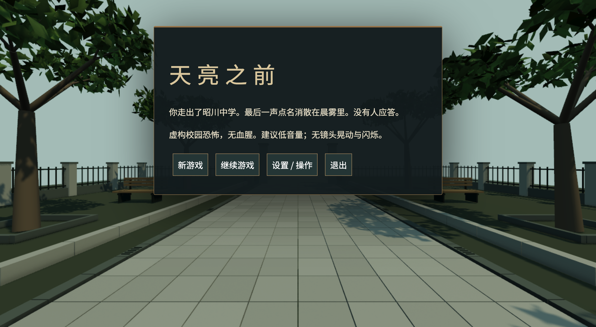

# 末铃点名 · 桌面单机恐怖逃生（开发中）

虚构的昭川中学里，晚自习已经结束，广播仍在点名。探索教室、档案室与广播室，寻找离校方法，避开仍在巡查的值班人。


主要交付是离线桌面软件，安装后无需Node、浏览器、账号或联网服务。20—30分钟是首次玩家设计目标，不是实测时长；高级商业音画品质及首次体验仍未完成验收。

## 下载与当前版本

[下载0.7.0开发预览](https://github.com/Tomhao10225101490/midnight-rollcall/releases/tag/v0.7.0)。M系列Mac选arm64 DMG/ZIP，Intel Mac选x64，Windows选安装EXE或便携EXE，Linux选AppImage或tar.gz。具体启动和单个可信应用的未签名处理见[安装说明](docs/INSTALL.md)。应用无Developer ID、苹果公证或Windows代码签名，不保证没有系统提示。

0.7新增门扇近景及打开后的实体碰撞、原创结局曲和晨光庭院，并修复快速恢复/暂停的音频竞争。本机已从Release下载的DMG/ZIP在 `release/downloads-0.7.0`，实际解压应用为 `artifacts/downloaded-0.7.0/末铃点名.app`。这些本机目录不提交到源码仓库；线上用户请使用上面的真实Release链接。

九个安装/网页包、字节数和SHA256见[0.7产物清单](docs/ARTIFACTS-0.7.0.md)，Release同时提供`SHA256SUMS.txt`。网页试玩页面未部署，桌面用户不需要网页包。

当前主分支为 `0.8.0` 候选，新增原创近景试卷、文具与材质，并让广播、配电和出口实体显示跟随谜题进度及铃声；尚未公开发布安装包。上方下载与平台验证结论对应 `v0.7.0` 标签；需要复现已发布版本时请检出该标签。

## 操作与玩法
WASD移动、鼠标/方向键观察、Shift奔跑、Ctrl潜行、E互动、H在储物柜前藏入/退出、J查看记录/楼层示意图/逐级提示、Esc暂停。柜内只能通过通风缝观察，被目击藏入会遭搜查。

奔跑制造声音并提高纪律值；安静行动逐步降低。值班人丢失视线后会检查最后动静位置及附近。铃响期间值班人停步听令、出口开放十二秒；不要碰到他。试卷、监考登记、档案、频道索引与配电记录构成完整解谜链。关键进度自动存档，设置保存到本机。

恐怖追逐，无血腥，无镜头晃动或刻意闪烁。请先调低音量；出现晕动不适时暂停。支持音量、灵敏度、视野、全屏、画面比例和接触阴影设置。

## 验证范围

| 平台 | 0.7实际产物 | 验证范围 |
|---|---|---|
| macOS arm64 | DMG、应用ZIP | CI下载ZIP解压后完整断网键鼠通关；DMG只读挂载/入口检查；Release下载文件与CI包逐字节一致，Release ZIP实际解压启动通过 |
| macOS x64 | DMG、应用ZIP | 对应系统runner构建、包检查通过，未实机试玩 |
| Windows x64 | 安装EXE、便携EXE | 对应系统runner构建、包检查通过，未实机试玩 |
| Linux x64 | AppImage、tar.gz | 对应系统runner构建、包检查通过，未实机试玩 |
| 浏览器 | 静态ZIP | 独立包普通键鼠第一道谜题、鼠标观察、音频暂停/静音、设置/全屏及刷新读档通过；Release包全部67个文件与可见Mac Chrome测试包内容一致；未整局 |

固定源提交e411ca05f9eea347de25e527c450c98c08ec0080。[原生构建](https://github.com/Tomhao10225101490/midnight-rollcall/actions/runs/43098439265)五job成功，[九包检查上传](https://github.com/Tomhao10225101490/midnight-rollcall/actions/runs/43100202536)成功。31项逻辑测试/typecheck、九包入口/版本及57个递归运行模块检查通过，公开前后11项远端资产与大小/SHA256清单一致。

完整桌面路线经历3次被捕后通过正常检查点续玩，没有瞬移、无敌或物品注入；Playwright会话网络禁用，HTTP与页面错误为零。熟知路线的自动操作不能代表首次玩家时长；音频信号检查不等于主观听感验收。[完整报告](FINAL_REPORT.md)。



## 从源码运行、测试与构建
Node.js 22及以上，在本项目目录运行：
```sh
npm ci
node node_modules/electron/install.js
npm run desktop
```
逻辑测试与构建：
```sh
npm run typecheck
npm test
npm run build
npm run dist
npm run dist:web
```
`npm run dist`生成当前系统的桌面包；跨平台发布使用对应系统的GitHub Actions runner。`npm run dev`在本机4173端口运行辅助浏览器构建。

以下桌面自动回归脚本已在macOS实测；默认使用Mac Electron，可通过 `ELECTRON_PATH` 指定应用可执行文件：
```sh
npm run test:desktop
npm run test:traverse
npm run test:search
npm run test:map
npm run test:defeat
npm run test:mix
npm run test:fonts
npm run test:score-reset
npm run test:pointer-transition
npm run test:ending-music
```
`test:traverse`使用正常键鼠路线、只读观察状态。macOS/Linux shell可用 `ROLLCALL_OFFLINE=1 npm run test:traverse`进行网络禁用回归。`test:mix`需要系统已安装离线中文语音。`npm run test:panels`直接挂载界面组件检查布局和输入，仅为组件验证。

可见Chrome回归：先保持 `npm run dev` 运行，再执行 `npm run test:browser`。默认使用Mac本机Google Chrome，支持 `BROWSER_PATH` 指定浏览器可执行文件和 `ROLLCALL_WEB_URL` 指定本地测试地址（包含`?qa=1`）。桌面与可见浏览器测试均须允许测试窗口获得焦点。

`npm run test:door-collision`通过正常键盘检查防夹、门扇阻挡和绕行。`test:ending-music`显式调用播放器组件，不等同于正常通关；逃生触发另由`test:traverse`验证。字体缺失恢复测试须先启动`npm run dev`，再运行`node scripts/font-failure-browser.mjs`，该脚本临时阻止字体请求后解除并检查重试。

## 原创与许可
原创代码MIT。几何、标牌、材质纹理和合成音乐由项目代码生成；不使用下载模型或音频。随包内置离线Noto Sans SC字体，按SIL OFL 1.1单独保留许可、版权与来源。中文语音只尝试本机离线系统声音，无声音时保留提示音与完整字幕。第三方软件保持各自许可，详见[第三方声明](THIRD_PARTY_NOTICES.md)。无账号系统、后端或遥测。

## English Quick Start

Offline desktop game under development. [Download the published 0.7.0 preview](https://github.com/Tomhao10225101490/midnight-rollcall/releases/tag/v0.7.0) for a bundled app. Native packages for macOS, Windows and Linux are available; physical playtesting was performed only on Apple Silicon Mac. From source: `npm ci`, `node node_modules/electron/install.js`, then `npm run desktop`. Use `npm test`, `npm run typecheck`, `npm run build`, and `npm run dist` for tests and native packaging. Final visual/audio quality and first-player duration acceptance remain pending.
